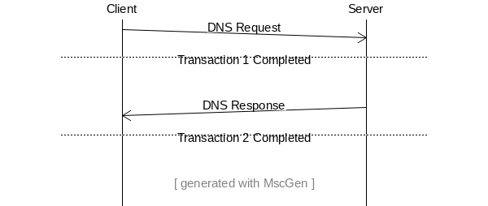
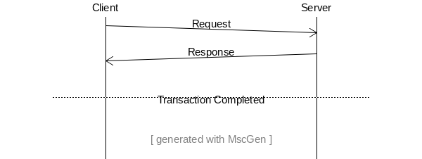
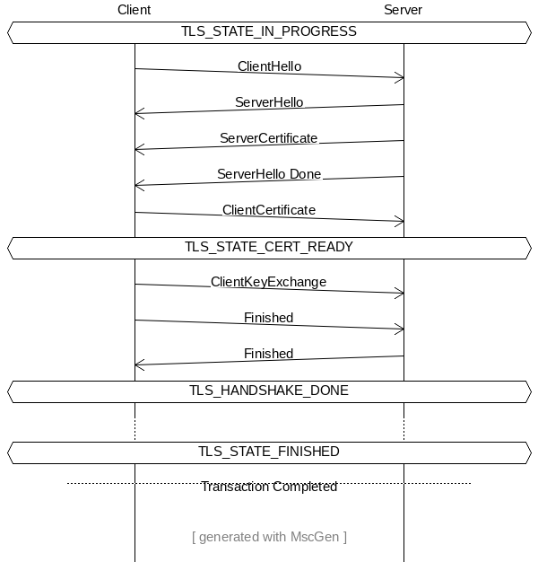
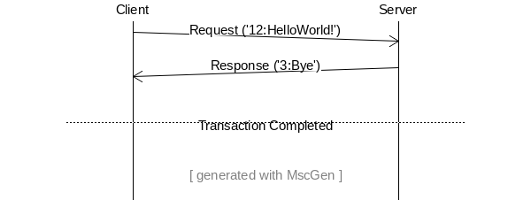

.. _transactions:

************
Transactions
************

.. contents:: Table of Contents

General Concepts
================

For Suricata, transactions are an abstraction that help with detecting and logging. An example of a complete transaction is
a pair of messages in the form of a request (from client to server) and a response (from server to client) in HTTP.

In order to know when to log an event for a given protocol, the engine tracks the progress of each transaction - that
is, when is it complete, or when it reaches a key intermediate state. They aid during the detection phase,
when dealing with protocols that can have large PDUs (protocol data units), like TCP, in controlling state for partial rule matching -- in case of rules that mention more than one field.

Transactions are implemented and stored in the per-flow state. The engine interacts with them using a set of callbacks the parser registers.

How the engine uses transactions
================================

All transactions share a common structure ``AppLayerTxData`` and a unique increasing id.

Logging
~~~~~~~

Suricata controls when logging should happen based on transaction completeness. For simpler protocols, such as ``dns``
or ``ntp``, that will most
likely happen once per transaction, by the time of its completion. In other cases, like with HTTP, this may happen at intermediary states.

In ``OutputTxLog``, the engine will compare current state with the value defined for the logging to happen, per flow
direction (``logger->tc_log_progress``, ``logger->ts_log_progress``). If state is less than that value, the engine skips to
the next logger. Code snippet from: suricata/src/output-tx.c:

.. code-block:: c

    static TmEcode OutputTxLog(ThreadVars *tv, Packet *p, void *thread_data)
    {
        .
        .
        .
            if ((ts_eof && tc_eof) || last_pseudo) {
                SCLogDebug("EOF, so log now");
            } else {
                if (logger->LogCondition) {
                    int r = logger->LogCondition(tv, p, alstate, tx, tx_id);
                    if (r == FALSE) {
                        SCLogDebug("conditions not met, not logging");
                        goto next_logger;
                    }
                } else {
                    if (tx_progress_tc < logger->tc_log_progress) {
                        SCLogDebug("progress not far enough, not logging");
                        goto next_logger;
                    }

                    if (tx_progress_ts < logger->ts_log_progress) {
                        SCLogDebug("progress not far enough, not logging");
                        goto next_logger;
                    }
                }
             }
        .
        .
        .
    }

Rule Matching
~~~~~~~~~~~~~

Transaction progress is also used for certain keywords to know what is the minimum state before we can expect a match: until that, Suricata won't even try to look for the patterns.

As seen in ``DetectAppLayerMpmRegister`` that has ``int progress`` as parameter, and ``DetectAppLayerInspectEngineRegister``, which expects ``uint8_t tx_min_progress``, for instance. In the code snippet,
``HTTP2ProgData`` and ``0`` are the values passed to the functions - in the last
example, for ``FTPDATA``,
the existence of a transaction implies that a file is being transferred. Hence the ``0`` value.

.. code-block:: c

    void DetectFiledataRegister(void)
    {
        .
        .
        DetectAppLayerMpmRegister("file_data", SIG_FLAG_TOSERVER, 2,
                PrefilterMpmFiledataRegister, NULL,
                ALPROTO_HTTP2, HTTP2ProgData);
        DetectAppLayerMpmRegister("file_data", SIG_FLAG_TOCLIENT, 2,
                PrefilterMpmFiledataRegister, NULL,
                ALPROTO_HTTP2, HTTP2ProgData);
        .
        .
        DetectAppLayerInspectEngineRegister("file_data",
            ALPROTO_HTTP2, SIG_FLAG_TOCLIENT, HTTP2ProgData,
            DetectEngineInspectFiledata, NULL);
        DetectAppLayerInspectEngineRegister(
                "file_data", ALPROTO_FTPDATA, SIG_FLAG_TOSERVER, 0, DetectEngineInspectFiledata, NULL);
        .
        .
    }

Progress Tracking
=================

As a rule of thumb, transactions will follow a request-response model: if a transaction has had a request and a response, it is complete.

But if a protocol has situations where a request or response won’t expect or generate a message from its counterpart,
it is also possible to have uni-directional transactions. In such cases, transaction is set to complete at the moment of
creation.

For example, DNS responses may be considered as completed transactions, because they also contain the request data, so
all information needed for logging and detection can be found in the response.

In addition, for file transfer protocols, or similar ones where there may be several messages before the file exchange
is completed (NFS, SMB), it is possible to create a level of abstraction to handle such complexity. This could be achieved by adding phases to the model implemented by the protocol (e.g., protocol negotiation phase (SMB), request parsed (HTTP), and so on).

This is controlled by implementing progress states. In Suricata, those will be enums that are incremented as the parsing
progresses. A state will start at 0. The higher its value, the closer the transaction would be to completion. Due to how
the engine tracks detection across states, there is an upper limit of 48 to the state progress (it must be < 48).

Entering a state does not imply that the state's data is present: a state is entered when the unit it names starts
being parsed, and the data (buffers, extracted fields) exists only once the unit has been fully parsed. Keywords
reading that data must tolerate the unit still arriving - buffer keywords bail out when the buffer's GetData
callback reports the buffer unavailable, and keywords reading extracted fields must gate on the field being
present rather than assume the state implies the data.

The engine interacts with transactions' state using a set of callbacks the parser registers. State is defined per flow direction (``STREAM_TOSERVER`` / ``STREAM_TOCLIENT``).

In Summary - Transactions and State
~~~~~~~~~~~~~~~~~~~~~~~~~~~~~~~~~~~

- Initial State value: ``0``.
- Simpler scenarios: State is simply a bool.  ``1`` represents transaction completion, per direction.
- Complex Transaction State in Suricata: ``enum`` (Rust: ``i32``). Completion is indicated by the highest enum value (some examples are: SSH, HTTP, HTTP2, DNS, SMB).

Examples
========

This section shares some examples from Suricata codebase, to help visualize how Transactions work and are handled by the engine.

Enums
~~~~~

Code snippet from: rust/src/ssh/ssh.rs:

.. code-block:: rust

    pub enum SSHConnectionState {
        SshStateBanner = 0,
        SshStateKex = 1,
        SshStateSession = 2,
        SshStateDone = 3,
    }

From src/app-layer-ftp.h:

.. code-block:: c

    enum {
        FTP_STATE_IN_PROGRESS,
        FTP_STATE_PORT_DONE,
        FTP_STATE_FINISHED,
    };

From src/app-layer-ssl.h:

.. code-block:: c

    enum {
        TLS_STATE_IN_PROGRESS = 0,
        TLS_STATE_CERT_READY = 1,
        TLS_HANDSHAKE_DONE = 2,
        TLS_STATE_FINISHED = 3
    };

API Callbacks
~~~~~~~~~~~~~

In Rust, this is done via the RustParser struct. As seen in rust/src/applayer.rs:

.. code-block:: rust

    /// Rust parser declaration
    pub struct RustParser {
            .
            .
            .
        /// Progress values at which the tx is considered complete in a direction
        pub tx_comp_st_ts:      c_int,
        pub tx_comp_st_tc:      c_int,
        .
        .
        .
    }

In C, the callback API is:

.. code-block:: c

    void AppLayerParserRegisterStateProgressCompletionStatus(
        AppProto alproto, const int ts, const int tc)

Simple scenario described, in Rust:

rust/src/dhcp/dhcp.rs:

.. code-block:: rust

    tx_comp_st_ts: 1,
    tx_comp_st_tc: 1,

For SSH, this looks like this:

rust/src/ssh/ssh.rs:

.. code-block:: rust

    tx_comp_st_ts: SSHConnectionState::SshStateDone as i32,
    tx_comp_st_tc: SSHConnectionState::SshStateDone as i32,

In C, callback usage would be as follows:

src/app-layer-dcerpc.c:

.. code-block:: c

    AppLayerParserRegisterStateProgressCompletionStatus(ALPROTO_DCERPC, 1, 1);

src/app-layer-ftp.c:

.. code-block:: c

    AppLayerParserRegisterStateProgressCompletionStatus(
        ALPROTO_FTP, FTP_STATE_FINISHED, FTP_STATE_FINISHED);

Sequence Diagrams
~~~~~~~~~~~~~~~~~

A DNS transaction in Suricata can be considered unidirectional:

An HTTP2 transaction is an example of a bidirectional transaction, in Suricata (note that, while HTTP2 may have multiple streams, those are mapped to transactions in Suricata. They run in parallel, scenario not shown in this Sequence Diagram - which shows one transaction, only):

action is completed.

A TLS Handshake is a more complex example, where several messages are exchanged before the transaction is considered completed:

 to Client and vice-versa, before a dotted line indicates that the transaction is finally completed.

Template Protocol
~~~~~~~~~~~~~~~~~

Suricata has a template protocol for educational purposes, which has simple bidirectional transactions.

A completed transaction for the template looks like this:

Following are the functions that check whether a transaction is considered completed, for the Template Protocol. Those are called by the Suricata API. Similar functions exist for each protocol, and may present implementation differences, based on what is considered a transaction for that given protocol.

In C:

.. code-block:: c

    static int TemplateGetStateProgress(void *txv, uint8_t direction)
    {
        TemplateTransaction *tx = txv;

        SCLogNotice("Transaction progress requested for tx ID %"PRIu64
            ", direction=0x%02x", tx->tx_id, direction);

        if (direction & STREAM_TOCLIENT && tx->response_done) {
            return 1;
        }
        else if (direction & STREAM_TOSERVER) {
            /* For the template, just the existence of the transaction means the
             * request is done. */
            return 1;
        }

        return 0;
    }

And in Rust:

.. code-block:: rust

    pub extern "C" fn rs_template_tx_get_alstate_progress(
        tx: *mut std::os::raw::c_void,
        _direction: u8,
    ) -> std::os::raw::c_int {
        let tx = cast_pointer!(tx, TemplateTransaction);

        // Transaction is done if we have a response.
        if tx.response.is_some() {
            return 1;
        }
        return 0;
    }

Per-Transaction Byte Value Cache
================================

A rule can produce a value with ``byte_extract`` or ``byte_math`` in one
buffer and use it in another, for example take a number from ``http.uri``
and feed it to a ``byte_test`` in ``http.stat_code``. The value has to
last until the consumer runs, and ``det_ctx->byte_values`` alone does not
provide that: it is one array per worker thread, indexed by ``local_id``,
and every signature and every transaction the worker inspects writes to
it.

A value can be overwritten in three ways. In a bidirectional (``=>``)
rule on a flow with pipelined HTTP requests, every transaction's toserver
buffers are inspected before any toclient buffer, so the second
transaction's ``byte_extract`` runs after the first one's producer and
before the first one's toclient consumer. In a unidirectional rule whose
producer and consumer sit at different progress levels, the consumer may
not run until a later packet, and another transaction on the same worker
can be inspected in between. The producer is not run again to make up for
it: once an inspect engine is done, its id is recorded in the signature's
``inspect_flags`` and the engine is skipped when the rule resumes. And
because every signature numbers its byte variables from 0, a second
signature that extracts from the same transaction writes the same slot.

So the transaction's ``DetectEngineState`` carries a list with one entry
per signature that has produced byte values on that transaction. An
entry holds the signature's internal id and one value per byte variable
in the signature, indexed by ``local_id``.

``DetectRunTxInspectRule()`` uses the list for signatures that have byte
variables (``s->byte_var_count``). Before the signature's packet matches
and engines run, it copies the signature's entry into
``det_ctx->byte_values``. A signature with no entry gets its slots
cleared, so a consumer that runs ahead of its producer reads 0 and not a
value left by another signature or transaction. ``byte_extract`` and
``byte_math`` set ``det_ctx->byte_vars_dirty`` when they write a value,
and wherever the function stores inspect state for a dirty signature it
also copies the values into the signature's entry, allocating it on
first use. Those are the passes after which completed engines are
skipped. A pass that stores no state starts over on the next packet and
produces its values again, so nothing is kept for it.

The list is freed with the ``DetectEngineState``, and by
``ResetTxState`` on a detect engine reload, since signature ids and
local ids belong to the ruleset that produced the values.

Rules inspected on the packet or frame path have no transaction to keep
values on, and a value lasts for that one inspection. Nothing clears
their slots first, and nothing needs to: a variable has to be produced
earlier in the rule than it is used, the packet engines run in rule
order, and a frame rule inspects one buffer, so a consumer there always
follows its producer.

The functions involved are ``DetectEngineStateRestoreByteVars()`` and
``DetectEngineStateSaveByteVars()`` in ``detect-engine-state.c``, and
``DetectRunTxLoadByteVars()`` and ``DetectRunTxKeepByteVars()`` in
``detect.c``.

Work In Progress changes
========================

An ongoing effort is to limit the number of transactions per flow, to prevent
Denial of Service (DoS) by quadratic complexity - a type of attack that may
happen to protocols which can have multiple transactions at the same time -
such as HTTP2 so-called streams (see https://redmine.openinfosecfoundation.org/issues/4530).

Common words and abbreviations
==============================

- al, applayer: application layer
- alproto: application layer protocol
- alstate: application layer state
- engine: refers to Suricata core detection logic
- flow: a bidirectional flow of packets with the same 5-tuple elements (protocol, source ip, destination ip, source port, destination port. Vlans can be added as well)
- PDU: Protocol Data Unit
- rs: rust
- tc: to client
- ts: to server
- tx: transaction
